# APM 项目设计文档

| 项目 | 内容 |
| --- | --- |
| 项目名称 | APM（Adrts package manager） |
| 文档版本 | v0.2（对齐当前实现） |
| 更新日期 | 2026-11-11 |
| 状态 | 已按当前实现更新，未决事项见第 15 节 |

> 本文档只记录当前已确认的设计内容，其余部分后续补充。凡标注「待定」的条目均未做技术决策。

## 1. 项目概述

APM 是一个面向 Windows 的命令行包管理器，主语言为 Python。

核心思路是**兼容并复用 Scoop 的软件源**：直接使用 Scoop 官方 bucket（main、extras 等）中的 JSON manifest 作为软件定义，APM 自身只负责解析 manifest、下载、校验、解压、安装与卸载。

目录模型与 Scoop 几乎一致，以降低理解成本和迁移成本。

## 2. 设计目标与约束

### 2.1 目标

- 复用 Scoop bucket，不自建软件源，不维护软件清单。
- 目录结构与 Scoop 保持一致，用户可以直接看懂安装结果。
- 安装包缓存与安装目录分离，缓存可复用、可清理。
- 安装与更新采用两阶段：先完成全部下载与校验，再统一执行安装。
- 用户配置与软件本体分离，升级/卸载不破坏用户数据。

### 2.2 非目标

- 全局安装与系统级修改：不写 `HKLM`、`Program Files`、系统 PATH，不请求管理员权限。
- 多用户共享安装：不做跨用户共享或系统级部署；有多个 Windows 用户时，各自安装一份。

### 2.3 运行环境

- 操作系统：Windows。
- 主语言：Python，最低支持 3.11（`shims\apm_setup.cmd` 按此校验），当前开发环境为 Python 3.14.10。
- 解释器：直接复用系统已安装的 Python，不内置、不下载独立运行时。
- 依赖：`shims\requirements.txt`，用户克隆后运行初始化脚本创建虚拟环境（`.venv`）并安装依赖。当前运行时只使用 Python 标准库，`requirements.txt` 暂无第三方依赖。
- 分发方式：Git 仓库分发。用户把仓库克隆到任意目录即可使用，不需要安装程序；APM 自身升级在仓库目录执行 `git pull`。建议使用 `--depth 1` 浅克隆，`git pull` 不会加深历史。
- 安装根目录记为 `<APM_ROOT>`，即仓库克隆目录，由启动器根据自身路径推导，不写死盘符，整份目录可移动。
- 首次使用需要两步：运行 `shims\apm_setup.cmd` 初始化虚拟环境与依赖；把 `<APM_ROOT>\shims` 加入用户 PATH。

## 3. 目录结构约定

```text
<APM_ROOT>\                # Git 克隆目录，位置任意
├── .venv\                 # Python 虚拟环境（本地生成，不入库）
├── shims\                 # 命令入口目录，加入 PATH
│   ├── apm.cmd / apm.ps1  # APM 自身入口
│   ├── apm_setup.cmd      # 初始化虚拟环境与依赖
│   └── requirements.txt   # Python 依赖清单
├── apps\                  # 已安装软件
│   ├── apm\               # APM 自身（仓库内）
│   │   ├── code\          # 主程序源码（apm 包）
│   │   └── supporting\    # vendored shim 等支撑文件
│   └── <app>\             # 各软件安装目录
├── buckets\               # 软件源，按 bucket 名称存放
├── cache\                 # 下载的安装包
├── persist\               # 软件持久化配置与数据
├── docs\                  # 设计文档
├── LICENSE
└── README.md
```

| 路径 | 用途 | 说明 |
| --- | --- | --- |
| `.venv\` | Python 虚拟环境 | 由 `shims\apm_setup.cmd` 用系统 Python 创建，不纳入 Git |
| `shims\` | 命令入口 | APM 自身入口（`apm.cmd` / `apm.ps1`）、初始化脚本与依赖清单；各应用的命令入口（vendored shim 副本 + `.shim`，或 `.cmd` 文本包装）也生成在此，用户把该目录加入 PATH |
| `apps\apm\code\` | 主程序源码 | `apm` 包的模块文件 |
| `apps\apm\supporting\` | 支撑文件 | vendored `shim.exe`（`shims\kiennq\`）与校验文件 |
| `apps\` | 软件安装目录 | 每个软件一个子目录，内部版本布局与 Scoop 一致 |
| `apps\apm\` | APM 自身 | 程序本体随仓库分发，不走安装流程 |
| `buckets\` | 软件源 | 每个 bucket 对应一个 depth=1 的 Git 浅克隆 |
| `cache\` | 安装包缓存 | 下载产物落盘位置，可随时清空 |
| `persist\` | 持久化数据 | 软件配置、用户数据，卸载时默认保留 |

除 `apps\apm\`、`shims\` 下的 `apm.cmd` / `apm.ps1` / `apm_setup.cmd` / `requirements.txt` 外，运行时目录、`shims` 下自动生成的应用入口文件与 `.venv` 均不纳入 Git 版本控制。

### 3.1 软件安装目录布局（与 Scoop 对齐）

```text
apps\<app>\
├── <version>\             # 实际安装内容
├── current\               # 指向当前版本，便于路径稳定
├── install.json           # 安装元数据，字段见 6.4
└── manifest.json          # 安装时的 manifest 副本
```

`current` 使用 NTFS 目录联接（junction），通过 `FSCTL_SET_REPARSE_POINT` 原生创建，失败时回退 `mklink /J`；不使用符号链接，避免开发者模式与额外权限要求。同一软件在磁盘上只保留一个版本，升级策略见 6.1。

## 4. 与 Scoop 的对应关系

| Scoop | APM | 说明 |
| --- | --- | --- |
| `SCOOP` | `<APM_ROOT>` | 仓库克隆目录 |
| `SCOOP_APPS` | `<APM_ROOT>\apps` | 软件目录 |
| `SCOOP_CACHE` | `<APM_ROOT>\cache` | 下载缓存 |
| `SCOOP_PERSIST` | `<APM_ROOT>\persist` | 持久化数据 |
| bucket 仓库 | `<APM_ROOT>\buckets\<bucket>\` | depth=1 浅克隆的软件源 |
| `bucket\<app>.json` | 同左 | 直接复用，不改造格式 |
| `apps\<app>\current` | 同左 | 当前版本入口 |
| `shims` | `<APM_ROOT>\shims` | 命令入口目录，APM 自身入口与各应用入口同址 |

APM 不修改 bucket 中的 manifest，解析层负责把 Scoop 的字段语义映射到 APM 的安装动作。

## 5. 系统架构

分为三层：

1. **CLI 层**：命令解析、参数校验、输出与交互。
2. **核心服务层**：
   - bucket 管理：添加、更新、列出、删除软件源。
   - manifest 解析：读取 JSON、字段校验、变量替换。
   - 下载与校验：缓存命中判断、HTTP 下载、哈希校验。
   - 安装引擎：解压、目录落位、`current` 切换、持久化链接。
   - 卸载与升级：版本清理、残留处理。
3. **基础设施层**：HTTP 客户端、归档解压、文件系统操作、日志、配置。

当前模块划分（均平铺于 `apps\apm\code\`）：

| 模块 | 职责 |
| --- | --- |
| `cli.py` | 命令解析、子命令分派、退出码 |
| `paths.py` | 由 `APM_ROOT` 推导全部运行目录 |
| `config.py` | `~/.config/apm/config.json` 读写、默认值合并、类型校验 |
| `buckets.py` | bucket 的浅克隆、刷新、删除、manifest 定位 |
| `manifest.py` | manifest 读取、校验、架构回退、字段解析、占位符替换 |
| `deps.py` | 依赖 DFS 解析与环检测 |
| `cache.py` | 缓存命名、枚举与清理 |
| `download.py` | 下载任务汇总、镜像改写、四种后端、并发调度 |
| `verify.py` | hashlib / 7-Zip 两种校验方式 |
| `extract.py` | 按扩展名解压、路径安全校验 |
| `install.py` | 两阶段安装、`current` 切换、bin/快捷方式/env/persist、元数据 |
| `uninstall.py` | 卸载与 persist 处理 |
| `installed.py` | `install.json` 读写、已安装列表、hold 标记读取 |
| `env.py` | `HKCU\Environment` 的 PATH 与环境变量读写 |
| `shortcuts.py` | 开始菜单快捷方式 |
| `ps.py` | 内联 PowerShell 钩子与 installer 执行 |
| `tools.py` | 7-Zip / innounp / 下载后端的外部工具查找 |
| `query.py` | list、search、info、status、cleanup |
| `output.py` | 统一 `[apm]` 前缀、着色、表头/汇总、失败清单与进度行 |
| `messages.py` | 全部用户可见文案、argparse 中文帮助文本与参数错误映射 |
| `util.py` | 路径、junction、硬链接、JSON、长路径等基础工具 |
| `errors.py` | `ApmError` 及分类异常 |
| `known_buckets.py` | 已知源清单加载器：读取 `apps\apm\buckets.json`（程序数据，不经过 `APM_ROOT`），清单可编辑而无需改代码 |

依赖边界：核心运行时只使用 Python 标准库与 Windows 自带能力（`winreg`、`ctypes`、`msiexec`、PowerShell、`curl.exe`）；`shims\requirements.txt` 当前为空。

## 6. 核心流程

安装与更新统一采用两阶段：先全部下载，再统一安装，与 Linux 包管理器的行为一致。

```text
阶段一：准备
  解析命令参数
  → 定位 bucket 与 manifest（含依赖）
  → 汇总下载清单并去重
  → 检查 cache，已命中的直接复用
  → 并行下载到 cache 并校验哈希
  → 单个失败不取消其他下载，APM 层不重试
  → 全部结束后只要有失败，终止整个安装流程

阶段二：提交（串行）
  → 按依赖顺序逐个解压到 apps\<app>\<version>\
  → 执行 pre_install
  → 运行 installer（如有）
  → 切换 apps\<app>\current\
  → 建立命令入口、快捷方式、环境变量与持久化链接
  → 执行 post_install
  → 删除旧版本目录（仅升级时）
  → 写入安装元数据
```

命令入口方式（对齐 Scoop 的 `shim` 函数）：为 manifest 中每个 `bin` 条目在 `<APM_ROOT>\shims\` 生成命令入口，按目标后缀分派——

- `.exe` / `.com` 目标：复制仓库内置的 vendored `shim.exe`（kiennq 变体）为 `<命令名>.exe`，并写旁车文件 `<命令名>.shim`（`path = "<目标的绝对路径>"`，可选 `args = ...`；与实际安装的 Scoop 行为一致——移动根目录后需重装应用重建入口，与 junction 存绝对目标的行为一致）；复制前校验 vendored 文件的 SHA-256，不符或缺失直接报错。
- `.ps1` / `.cmd` / `.bat` 及其他目标：生成 `<命令名>.cmd` 文本包装脚本。
- 同名入口的旧变体（`.cmd` / `.exe` / `.shim`）在写入前统一清除。

- 包装脚本直接调用目标文件并透传 `%*` 与 `%ERRORLEVEL%`。
- `.ps1` 目标使用 `powershell.exe -NoProfile -ExecutionPolicy Bypass -File` 调用；`.cmd` / `.bat` 目标使用 `call`；其余目标直接执行。
- 命令名默认取目标文件名去掉扩展名；manifest 指定别名时使用别名。
- 命令名不能包含路径分隔符，也不能是 `apm` 本身；同名入口被覆盖时输出警告。
- 目标解析顺序：`current` 下 → 版本目录下 → 当前 PATH。

### 6.1 版本策略

- 同一软件在磁盘上**只保留一个版本**，不再保留历史版本。
- 升级流程：新版本先解压到独立的 `<新版本>` 目录 → 校验通过后切换 `current` → 删除旧版本目录。
  - 切换通过 `.apm-current-new` 中转、把旧联接改名为 `.apm-current-old`，再原子换入；失败时恢复旧联接。
  - 切换前失败：旧版本保持可用，`current` 不变。
  - 切换后清理失败：不影响使用，残留目录由 `apm cleanup` 处理。
- 不提供多版本并存、`reset` 切换版本或回滚能力。
- 当前不支持安装历史版本：`app@version` 语法可用，但版本必须等于 bucket 当前 manifest 的版本，否则直接报错；「降级」需等待 bucket 提供目标版本。
- 正在运行的进程会锁定安装目录，可能导致旧版本删除失败；当前只输出警告并保留残留目录，由 `apm cleanup` 处理，不自动结束进程。
- 版本号仍体现在目录名与安装元数据中，便于诊断与展示。

### 6.2 两阶段的边界与失败处理

- 阶段一与阶段二的分界即事务边界：阶段一失败时，除 cache 外不产生任何磁盘变更。
- APM 层不发起重试；单个包失败不取消其他包的下载，所有任务结束后统一判定。外部下载器自身的重试行为见 7.2。
- 只要存在下载失败，就不进入阶段二；已成功下载的文件保留在 cache，供下次复用。
- 阶段二逐包串行执行，每个包完成后记录状态；某包失败时停止后续包并输出失败清单。
- 已完成的包不回滚；manifest 中的安装脚本可能产生外部副作用，无法可靠撤销。
- 不提供「全部成功或全部撤销」的强事务语义。
- 阶段二开始前的磁盘空间检查尚未实现。
- manifest 中的 `depends` 解析见 6.3。

### 6.3 依赖解析

- `depends` 为字符串或数组，元素是 `app` 或 `bucket/app`。
- 解析算法：递归 DFS + 后序输出。
  - `resolved`：已确定安装顺序的节点。
  - `visiting`：当前递归栈，用于检测环。
  - 节点在自身依赖全部处理完后才加入 `resolved`，因此依赖总排在依赖者之前。
- 示例：
  - A → B → C：最终顺序为 C、B、A。
  - A → B、A → C、B → C：最终顺序为 C、B、A，C 只出现一次。
- 环检测：递归进入节点前若它已在 `visiting` 中，立即报错并输出完整链路（A → B → A），阶段一不下载任何文件。
- 去重：以应用名为身份；同一依赖被多个包引用只安装一次。
- 已安装的依赖：
  - `install`：直接跳过，不重复安装；`depends` 没有版本约束，因此不比较版本。
  - `update <app>`：不递归更新依赖，只在依赖缺失时补装；依赖自身的更新由 `update <dep>` 或 `update *` 负责。
- `bucket/app` 指定 bucket；只写 `app` 时按 10.1 的 bucket 优先级查找，歧义时提示。
- 依赖的 manifest 不存在、或依赖所在 bucket 未添加：阶段一直接失败，整个计划不执行。
- `suggest` 只提示，不进入解析计划。
- 助手工具（7zip、innounp 等）不写入 `depends`，也不自动加入安装计划；按 7.5 的外部工具查找处理，缺失时报错并给出安装建议。这一点与 Scoop 的 `Get-InstallationHelper` 不同。
- 阶段二按拓扑序提交；某依赖安装失败时停止后续依赖它的包，已完成的包不回滚。

### 6.4 安装元数据

每个应用目录下保留两份文件，供已安装查询、升级与卸载回放使用：

```text
apps\<app>\
├── install.json      # 安装元数据
├── manifest.json     # 安装时使用的 manifest 副本
├── <version>\
└── current\
```

`install.json` 字段：

| 字段 | 说明 |
| --- | --- |
| `app` | 应用名 |
| `version` | 已安装版本 |
| `bucket` | 来源 bucket |
| `architecture` | 安装时选择的架构 |
| `installed_at` | 安装时间（ISO 8601） |
| `hold` | 是否锁定版本 |
| `bin` | 已创建的命令入口名列表 |
| `shortcuts` | 已创建的快捷方式名列表 |
| `env_set` | 已写入的环境变量名列表 |
| `env_add_path` | 已加入用户 PATH 的目录列表 |
| `persist` | `[源相对路径, persist 相对路径]` 列表 |
| `manifest` | 固定为 `manifest.json` |
| `source` | 安装时 manifest 的来源路径 |

`manifest.json` 是安装时的快照：bucket 被删除或清单变化后，卸载仍能按安装时的字段执行 `uninstaller`、快捷方式与环境变量清理。

## 7. 下载后端

下载能力抽象为统一接口，后端可替换。当前支持四种：

| 后端 | 依赖 | 优势 | 限制 |
| --- | --- | --- | --- |
| `python` | 无，Python 标准库 | 零依赖、行为可控，便于统一做哈希校验与进度 | 仅 HTTP/1.1，无多连接分片，断点续传需自行实现 Range |
| `aria2` | 外部 `aria2c` | 多连接分片、断点续传，大文件最快 | 需额外安装；存在「用 APM 装 aria2 才能用 aria2 下载」的引导问题 |
| `curl` | Windows 10 1803+ 自带 `curl.exe` | 系统自带，支持续传、代理、TLS | 需解析退出码与进度输出，不同版本行为有差异 |
| `wget` | 通常需额外安装 | 支持 `-c` 续传 | Windows 非自带，路径与编码问题较多；不自带 Windows 根证书，需通过 `cacert` 包生成的 `wget.ini` 指定 CA 证书 |

说明：

- Scoop 的默认下载走 PowerShell / .NET 的 `Invoke-WebRequest`。APM 不使用 PowerShell 下载，对应能力由 `python` 后端提供。
- Python 没有独立于 HTTP 协议的官方下载器，内置方案是标准库 `urllib.request`（底层为 `http.client`）；第三方可选 `requests`、`httpx`、`aiohttp`、`pycurl`：
  - `requests`：API 简单、生态成熟，不支持 HTTP/2。
  - `httpx`：支持 HTTP/2，提供同步与异步接口。
  - `aiohttp`：适合异步并发下载。
  - `pycurl`：libcurl 绑定，能力等同 `curl`。
- 建议 `python` 后端基于标准库 `urllib` 实现，避免为下载引入重型依赖；确有 HTTP/2 或高并发需求时再引入 `httpx`。

### 7.1 后端选择策略

- 配置项 `download.backend`（见第 8 节）：`python` / `aria2` / `curl` / `wget`，默认 `python`，必须显式指定其一。
- 不提供自动选择：指定的后端未安装或不可用时直接报错，不静默切换。
- 外部后端（`aria2c.exe` / `curl.exe` / `wget.exe`）按「`shims\<exe>` → PATH」两阶段查找：先找 APM 生成的用户级命令入口，未安装时才使用 PATH 中的系统版本。`shims` 入口由 manifest 的 `bin` 生成，能覆盖任意应用名和安装布局，不直接按应用目录猜测路径。
- 之所以不能依赖 PATH：Windows 组合环境块时，`Path` 是唯一被拼接而非覆盖的变量，顺序固定为「系统 PATH（HKLM）在前、用户 PATH（HKCU）追加在后」。因此 `env_add_path` 的前插只作用于用户段，永远排在 `C:\Windows\System32` 之后；系统自带 `curl.exe` 会先于 APM 的 `shims\curl.exe` 命中。`where <exe>` 可直接验证该顺序。
- 无论使用哪个后端，**哈希校验、缓存落盘、进度展示与失败清理由 APM 统一负责**，外部后端只负责将字节写入临时文件。
- User-Agent 统一为 `APM/0.1`；`python` 与 `curl` 显式设置，`wget`、`aria2` 通过各自参数设置。
- 超时：`python` 60 秒；`curl` 连接超时 30 秒；`wget` 60 秒；`aria2` 使用自身默认值。
- 重定向：`python`、`curl`、`wget` 跟随；`aria2` 使用自身默认行为。
- `wget` 后端依赖 `cacert` 包提供的 CA 证书：`wget` 的 `post_install` 会把 `ca_certificate=$(appdir cacert $global)\current\cacert.pem` 写入 `wget.ini`。若 `wget.ini` 缺失或路径无效，会出现 TLS 证书校验失败；需重新安装 `cacert` / `wget`，或手动修正 `wget.ini`。
- 代理：APM 未提供独立代理配置。`python`、`curl`、`wget` 会沿用进程环境变量中的代理设置，`aria2` 未传代理参数。

当前各后端的实际调用方式：

| 后端 | 实现 |
| --- | --- |
| `python` | `urllib.request.urlopen`，60 秒超时，256 KiB 分块写入，自动跟随重定向 |
| `aria2` | `aria2c --dir <cache> --out <缓存名> --split N --max-connection-per-server N --allow-overwrite=true --auto-file-renaming=false --file-allocation=none --max-tries=1 --console-log-level=warn --summary-interval=0` |
| `curl` | `curl.exe -L --fail --retry 0 --silent --show-error --output <临时文件> --connect-timeout 30` |
| `wget` | `wget.exe --no-verbose --output-document <临时文件> --timeout=60 --tries=1` |

其中 `N` 为 `download.concurrency.segments`。

### 7.2 并发模型与临时文件

- 默认后端：`python`。
- 断点续传：暂不规划。APM 层不实现续传；外部下载器自身的行为（如 aria2 的 `.aria2` 控制文件）不纳入保证范围。
- 重试：APM 层不发起重试；四种后端均显式只尝试一次——`curl` 用 `--retry 0`、`aria2` 用 `--max-tries=1`、`wget` 用 `--tries=1`、`python` 单次请求不循环。
- 并发分两级，均由配置项控制，互不混用：
  - 多软件并发：同时下载的安装包数量，对应 `download.concurrency.apps`。
  - 单文件分片并发：单个安装包的分片连接数，对应 `download.concurrency.segments`，仅对支持分片的后端（`aria2`）生效；`python`、`curl`、`wget` 固定为 1。
- 分片大小不作为配置项，交由下载器使用自身默认值（例如 aria2 不传 `--min-split-size`）。
- 临时文件命名与 Scoop 一致：
  - 非 aria2 后端先写入 `<缓存文件名>.download`，校验通过后再重命名为正式缓存文件。
  - aria2 直接写入缓存文件，中断时额外残留 `<缓存文件名>.aria2` 控制文件。
- 缓存文件命名同样对齐 Scoop：`<app>#<version>#<URL 的 SHA-256 前 7 位><扩展名>`。

### 7.3 哈希校验

算法识别与 Scoop 的 `get_hash` 一致：

| manifest 写法 | 使用算法 |
| --- | --- |
| 64 位十六进制、无前缀 | SHA-256 |
| `md5:` + 32 位十六进制 | MD5 |
| `sha1:` + 40 位十六进制 | SHA-1 |
| `sha256:` + 64 位十六进制 | SHA-256 |
| `sha512:` + 128 位十六进制 | SHA-512 |

- 比较前统一转小写，大小写不敏感。
- `hash` 为数组时，按 `url` 数组下标一一对应；URL 不在 `url` 列表中则报错。
- 无法识别的算法前缀直接报错，不做降级。

实现方式（默认 `hashlib`，外部 7-Zip 方式见 7.4）：

- 使用 Python 标准库 `hashlib`。优先用 `hashlib.file_digest()` 计算；不可用或算法不被接受时回退到 1 MiB 分块 `update()`，避免整文件读入内存。
- MD5 在 FIPS 模式下使用 `usedforsecurity=False`，否则会直接抛异常。
- 计算时机统一放在下载完成之后，由 APM 对所有后端（含 aria2）执行；不在下载流中顺带计算，保证四种后端行为一致。
- 缓存命中也重新校验，通过后才复用；不通过则删除该缓存条目并重新下载。
- 缺少 `hash` 字段时，`hashlib` 方式输出警告和实际 SHA-256 后继续；`7zip` 方式的行为见 7.4。
- 校验失败时删除该包的缓存文件与临时文件，标记失败且不重试；其他包继续下载，全部结束后终止安装流程。
- `hash` 中的 `mode`、`url` 等 hash extraction 字段只用于 autoupdate，安装阶段忽略。

### 7.4 校验方式：hashlib 与 7-Zip

`verify.method` 必须显式指定，二选一，不做自动切换：

| 取值 | 实现 | 说明 |
| --- | --- | --- |
| `hashlib` | Python 标准库 | 默认值，适用于所有文件 |
| `7zip` | 外部 `7z.exe` | 外部工具校验；无 hash 时可退化为压缩包完整性测试 |

`hashlib` 分支：

- 按 7.3 的算法识别与分块读取实现。
- `hash` 缺失：输出警告和实际 SHA-256，继续。
- 哈希不一致：删除文件与临时文件，标记该包失败，不重试。

`7zip` 分支：

- 7z 查找顺序：`verify.seven_zip` → `shims\7z.exe` → PATH 中的 `7z.exe`；配置项填写后文件必须存在，否则直接报错，不静默回退。
- manifest 有 `hash`：执行 `7z h -scrc<算法> "<文件>"`（例如 `-scrcSHA256`），从输出中解析 `<算法> for data: <哈希>` 并与 manifest 对比；7-Zip 不支持该算法时直接报错。
- manifest 无 `hash`：退化为 `7z t -y "<文件>"` 完整性测试。退出码 `0` 通过，`1` 警告后继续；识别为非压缩包时警告后继续；其他退出码失败。
- 校验失败：删除文件与临时文件，标记该包失败，不重试。

两种方式的收尾一致：通过后返回下载任务；失败时删除本次产生的文件并标记该包失败，是否终止由全部下载任务结束后的汇总判定。

### 7.5 解压实现

按扩展名分派，规则对齐 Scoop 的 `Invoke-Extraction`：

| 扩展名 | 处理方式 |
| --- | --- |
| `.zip` / `.nupkg` | 优先外部 7z（文件名编码兼容更好）；没有 7z 时用标准库 `zipfile` |
| `.7z` / `.rar` / `.iso` / `.img` / `.lzma` / `.lzh` / `.001` | 外部 7z |
| `.tar` / `.tar.gz` / `.tgz` / `.tar.bz2` / `.tar.xz` | 标准库 `tarfile`，失败时回退 7z |
| `.gz` / `.bz2` / `.xz` | 标准库 `gzip` / `bz2` / `lzma`，失败时回退 7z |
| `.tar.zst` / `.zst` | 外部 7z |
| `.msi` | `msiexec /a` 管理安装解包 |
| `.exe` 且 `innosetup: true` | `innounp -x` |
| 其他 `.exe` | 不解压，交给 `installer` 执行 |

实现要点：

- 外部工具查找顺序：配置项（`extract.seven_zip` / `extract.innounp`）→ `shims\<exe>` → PATH；配置项填写后文件必须存在，否则直接报错。
- 可安装的外部工具（`git`、`7z`、`innounp`、`curl`、`wget`、`aria2c`、`pwsh`）统一按上述顺序解析；`msiexec`、`cmd` 等 Windows 内置组件直接调用系统命令，不经过 `shims`。
- 解压目标为 `apps\<app>\<version>\`。存在 `extract_dir` 时先解压到临时目录 `_tmp`，再把 `_tmp\<extract_dir>` 移到版本根目录，最后删除 `_tmp`。
- `extract_dir` 为数组时，按实际发生解压的安装包顺序一一对应，不是候选回退；不需要解压的安装包不占用下标。
- `extract_to` 当前未实现：检测到该字段时输出警告并忽略。
- `zip` / `nupkg` 使用标准库 `zipfile` 时，先解压到 `_tmp_zip_<随机>` 再合并到目标目录，避免同名条目互相覆盖。
- `tar` 系列先解压到 `_tmp_tar_<随机>` 再合并；标准库失败时回退 7-Zip。
- `.gz` / `.bz2` / `.xz` 单文件解压时，输出文件名为去掉压缩扩展名后的名称；标准库失败时回退 7-Zip。
- `.tar.zst` 先用 7-Zip 解出内层 `.tar`，再解压该 tar。
- 直接从 cache 读取安装包解压，不复制到版本目录；解压成功后也不删除 cache 中的安装包。
- 解压失败时删除不完整的新版本目录，保留旧版本。
- 路径安全（仅标准库解压路径逐条目校验）：拒绝绝对路径、盘符、`..` 越界条目、包含 `<>:"|?*` 的条目、以空格或点结尾的条目，以及 Windows 保留名（`CON`、`PRN`、`AUX`、`NUL`、`COM1`-`COM9`、`LPT1`-`LPT9`）；符号链接与硬链接目标必须落在目标目录内，否则拒绝。
- 外部 7-Zip、`msiexec`、`innounp` 的解压结果不做逐条目复检，依赖工具自身的安全行为。
- 超长路径在长度达到 240 个字符时使用 `\\?\` 前缀（UNC 路径转 `\\?\UNC\`）。
- 编码：zip 条目未标记 UTF-8 时按 CP437 取原始字节，再尝试按 GBK 解码，失败则保留原名；外部 7z 由其自行处理编码。
- 权限与 ACL 不单独处理，继承 APM 目录的权限。
- MSI 使用 `msiexec /a <msi> /qn TARGETDIR=<临时目录>`，完成后把 `SourceDir` 内容移到目标目录。
- `.001` 当前只检查同名前缀的分卷文件是否存在（至少包含自身）；缺卷最终由 7-Zip 解压时报错。

### 7.6 下载地址加速（镜像）

在进入下载后端之前，先判断 URL 是否属于可加速地址：

- 匹配规则：URL 字符串包含 `github.com` 或 `sourceforge.net`（大小写不敏感），且协议为 http/https。
- 配置项：
  - `download.mirror.github`：GitHub 加速前缀。
  - `download.mirror.sourceforge`：SourceForge 加速前缀。
- 命中且已配置前缀时，改写为 `<前缀>/<原始 URL>`；未配置前缀时输出一次提示，按原地址下载。
- 非可加速地址原样通过。

约束：

- 缓存键、哈希匹配和 `hash_for_url` 一律使用**原始 URL**；加速只影响实际传输地址，切换前缀不会导致缓存失效。
- 不重复加前缀：URL 已经以配置的前缀开头时直接使用。
- 镜像下载失败直接判定为本次下载失败，不回退原地址、不切换其他镜像或后端、不重试；取消配置即可恢复直连。
- 镜像只作用于软件下载，不作用于 bucket 的 git 克隆/更新和 APM 自身更新。
- 无内置默认前缀：`github` / `sourceforge` 留空即完全不启用镜像，需用户显式填写。
- 不提供可用性探测：APM 不主动测速、不自动挑选或轮换前缀，配置什么就用什么。
- 加速前缀属于第三方服务，由用户自行选择并承担可用性风险。

## 8. 配置

- 配置文件路径：`%USERPROFILE%\.config\apm\config.json`，与 Scoop 的 `%USERPROFILE%\.config\scoop\config.json` 在位置和格式上保持一致。
- 放在用户目录而不是安装根目录：重装或迁移 APM 根目录时配置不丢失。
- 格式：JSON，使用 Python 标准库 `json` 读写，不引入额外依赖。
- 首次运行时自动创建目录与默认配置文件；文件缺失时按内置默认值运行。
- 默认生成的 `config.json` 在每个选项旁附带同名「键#」说明字段（JSON 不支持注释），介绍取值范围与留空效果；「#」字段运行时忽略、不参与校验，用户可自行改写作为备注。
- 已存在的旧配置文件不自动回填说明；删除 `config.json` 后运行任意命令即可重新生成带说明的默认配置。
- JSON 中的 Windows 路径必须写成双反斜杠，例如 `C:\\Program Files\\7-Zip\\7z.exe`；解析失败时报告文件名、行号、列号并提示该转义规则。
- 配置项使用点号命名，与 Scoop 的配置键风格保持一致。

下载方式作为配置项写入：

```json
{
  "download": {
    "backend": "python",
    "concurrency": {
      "apps": 3,
      "segments": 5
    },
    "mirror": {
      "github": "",
      "sourceforge": ""
    }
  },
  "verify": {
    "method": "hashlib",
    "seven_zip": ""
  },
  "extract": {
    "seven_zip": "",
    "innounp": ""
  }
}
```

- `backend` 取值范围：`python` / `aria2` / `curl` / `wget`，必须显式指定，含义见第 7.1 节。
- `download.mirror.github` / `download.mirror.sourceforge` 为加速前缀，无默认值，必须手动填写，留空表示直连，规则见第 7.6 节。
- `verify.method` 取值 `hashlib` / `7zip`，必须显式指定，默认 `hashlib`，规则见第 7.4 节。
- `verify.seven_zip` 可指定 `7z.exe` 路径，留空则按第 7.4 节的顺序自动查找。
- `extract.seven_zip` / `extract.innounp` 可指定外部工具路径，留空则按第 7.5 节的顺序自动查找。
- `concurrency.apps` 为多软件并发数，`concurrency.segments` 为单文件分片并发数；`segments` 仅对 aria2 生效，`python`、`curl`、`wget` 按 1 处理，含义见第 7.2 节。
- 优先级：设计上为命令行参数 > 配置文件 > 内置默认值；当前命令行没有覆盖配置的参数，实际只使用「配置文件 > 内置默认值」。
- APM 不提供 `config` 子命令：配置文件由用户直接编辑 `%USERPROFILE%\.config\apm\config.json`，文件缺失时自动创建默认内容。
- 配置值会在读取时按默认值类型校验；取值非法时直接报错，不回退到默认值。

完整配置项与默认值：

| 配置项 | 默认值 | 说明 |
| --- | --- | --- |
| `download.backend` | `python` | 下载后端，可选 `python` / `aria2` / `curl` / `wget` |
| `download.concurrency.apps` | `3` | 多软件并发下载数 |
| `download.concurrency.segments` | `5` | 单文件分片并发数，仅 aria2 生效 |
| `download.mirror.github` | 空 | GitHub 加速前缀，留空表示直连 |
| `download.mirror.sourceforge` | 空 | SourceForge 加速前缀，留空表示直连 |
| `verify.method` | `hashlib` | 校验方式，可选 `hashlib` / `7zip` |
| `verify.seven_zip` | 空 | 校验用 `7z.exe` 路径，留空按查找顺序自动定位 |
| `extract.seven_zip` | 空 | 解压用 `7z.exe` 路径，留空按查找顺序自动定位 |
| `extract.innounp` | 空 | `innounp.exe` 路径，留空按查找顺序自动定位 |

## 9. 启动器与命令入口

Windows 的 `PATHEXT` 默认不包含 `.PY`，直接输入 `apm` 不会执行 Python 脚本，必须写成 `python apm.py`。为了让调用方式与 Scoop 一致（`apm install ...`），需要一个无前缀的启动器。

### 9.1 入口形态对比

| 方案 | 是否同窗口 | 兼容性 | 结论 |
| --- | --- | --- | --- |
| `apm.cmd` | 是 | cmd 与 PowerShell 都能从 PATH 解析 | 主入口 |
| `apm.ps1` | 是（在 PowerShell 当前进程内执行） | 受 ExecutionPolicy 限制 | 可选补充 |
| 原生 exe shim | 是 | 最好，无 cmd 中转，无 Ctrl+C 提示 | 后续可选 |

结论：以 `apm.cmd` 作为主入口，`apm.ps1` 作为 PowerShell 环境下的可选入口，不提供 `.py` 直接入口。

### 9.2 apm.cmd 设计

```bat
@echo off
setlocal
for %%I in ("%~dp0..") do set "APM_ROOT=%%~fI"
set "APM_PY=%APM_ROOT%\.venv\Scripts\python.exe"
if not exist "%APM_PY%" (
    echo [apm] Virtual environment not found. Run shims\apm_setup.cmd first.
    exit /b 1
)
set "PYTHONUTF8=1"
"%APM_PY%" "%APM_ROOT%\apps\apm\code\__main__.py" %*
exit /b %ERRORLEVEL%
```

关键点：

- 直接调用控制台子系统程序 `python.exe`，子进程继承当前控制台，**不会新建窗口**。
- 禁止使用 `start`、`powershell -Command Start-Process`、`pythonw.exe` 等方式启动，这些都会脱离或隐藏当前窗口。
- `%*` 原样透传参数（保留引号），`exit /b %ERRORLEVEL%` 透传退出码，保证脚本/CI 可判断成败。
- `PYTHONUTF8=1` 保证中文输出不乱码；`setlocal` 避免污染调用方环境。
- `%~dp0` 以脚本自身位置解析路径，不依赖当前工作目录；`for %%I ... %%~fI` 把 `APM_ROOT` 规范化为绝对路径，目录整体移动后无需改配置。
- 启动器位于根目录 `shims\`，与各应用的入口文件同目录，用户只需把 `shims` 一个目录加入 PATH。
- 源码目录为 `apps\apm\code\`（包目录名为 `code`），`__main__.py` 启动时把自身注册为 `apm` 包再调用 CLI，因此启动器无需设置 `PYTHONPATH`。
- 只用 `.venv` 中的解释器运行，不使用系统全局环境，保证依赖版本可控。
- 虚拟环境不存在时直接提示并退出，不静默回退到系统 Python。

### 9.3 apm.ps1 设计（可选）

```powershell
$env:APM_ROOT = (Resolve-Path (Join-Path $PSScriptRoot '..')).Path
$python = Join-Path $env:APM_ROOT '.venv\Scripts\python.exe'
if (-not (Test-Path $python)) {
    Write-Host '[apm] Virtual environment not found. Run shims\apm_setup.cmd first.'
    exit 1
}
$env:PYTHONUTF8 = '1'
& $python (Join-Path $env:APM_ROOT 'apps\apm\code\__main__.py') @args
exit $LASTEXITCODE
```

`.ps1` 在 PowerShell 当前进程内执行，同样不会新建窗口；但可能被执行策略拦截，因此只作为补充，不作为主入口。

### 9.4 解释器与依赖

- 解释器直接复用系统已安装的 Python，APM 不自带、不下载独立运行时。
- 依赖清单为 `shims\requirements.txt`，版本全部固定；当前只依赖标准库，文件内容为空清单。
- `shims\apm_setup.cmd` 的检测顺序为：PATH 中的 `python`（要求 ≥ 3.11）→ `py -3`（要求 ≥ 3.11）→ 报错；随后创建 `.venv`、升级 pip、安装 `requirements.txt` 中的依赖。
- 克隆后必须先执行一次 `shims\apm_setup.cmd`，之后启动器只使用 `.venv\Scripts\python.exe`。
- `git pull` 更新自身后若依赖有变化，需重新执行 `shims\apm_setup.cmd`。
- 系统未安装 Python 或版本过低时，`shims\apm_setup.cmd` 直接报错并说明最低版本要求。

### 9.5 已知取舍

- `.cmd` 文本包装中按 Ctrl+C 后可能出现 `Terminate batch job (Y/N)?` 提示；`.exe` / `.com` 目标已改用原生 shim，无此问题。
- `.cmd` 每次调用会多启动一个 `cmd.exe`，开销可忽略。
- 工作目录：APM 不改变调用方的工作目录；`pre_install` / `post_install` 等钩子与 `installer` 以应用版本目录为工作目录执行。
- PATH 的写入方式见第 11 节。

## 10. Manifest 解析规则

解析规则以本机已安装的 Scoop 源码（`C:\Users\23670\Software\scoop\apps\scoop\current\lib`）和 `schema.json` 为准；字段统计样本为该机 main bucket 的 1711 个清单。

### 10.1 定位与读取

- bucket 根目录为 `buckets\<bucket>\`。若其中存在 `bucket\` 子目录，清单路径为 `buckets\<bucket>\bucket\<app>.json`；否则直接使用仓库根目录（兼容扁平结构的第三方 bucket）。
- 应用名取清单文件名去掉 `.json`，并按 Scoop 的 `sanitary_path` 规则处理非法字符。
- 文件按 UTF-8 读取，允许 BOM。
- 同名应用出现在多个 bucket 时，按 bucket 添加顺序取第一个并提示歧义。
- 解析失败或缺少必填字段（`version`、`homepage`、`license`）时直接报错，不做猜测。

### 10.2 架构选择

- 取值顺序与 Scoop 的 `arch_specific` 一致：先取 `architecture.<arch>.<field>`，不存在时回退到顶层同名字段。
- 支持 `64bit`、`32bit`、`arm64`。
- `arm64` 清单未提供 `url` 时：Windows 11（build ≥ 22000）回退 `64bit`，Windows 10 回退 `32bit`。
- 最终仍取不到 `url` 时判定为不支持当前架构，终止该包安装。

### 10.3 字段解析

| 字段 | 类型 | 解析规则 | main 出现次数 |
| --- | --- | --- | --- |
| `version` | string | 必填，必须匹配 `^[\w.\-+_]+$`；允许 `nightly` 字面值 | 1711 |
| `url` | string / array | 与 `hash` 按顺序一一对应；多个 URL 全部下载并解压；`installer.file` 缺省取第一个 URL 的文件名；URL fragment 以 `/` 开头时作为保存文件名（如 `#/cacert.pem`，Scoop 兼容） | 320（顶层） |
| `hash` | string / array | 64 位十六进制按 SHA-256；也支持 `sha1:` / `sha256:` / `sha512:` / `md5:` 前缀 | 320（顶层） |
| `architecture` | object | 键为 `64bit` / `32bit` / `arm64`，内容与顶层字段同构 | 1427 |
| `extract_dir` | string / array | 解压目录；数组按实际发生解压的安装包顺序一一对应 | 248 |
| `extract_to` | string / array | 解压到应用目录下的指定子目录，数组对应规则同上；当前版本警告后忽略 | 7 |
| `bin` | string / array / 嵌套 array | 见 10.4 | 1566 |
| `shortcuts` | array | 每项 `[目标, 名称, 参数?, 图标?]`，目标相对 `$dir` | 53 |
| `persist` | string / array | 目标为 `persist\<app>\<target>`；已存在的目录用 junction，已存在的文件用硬链接；目标不存在时先创建目录并按 junction 处理 | 162 |
| `env_add_path` | string / array | 相对应用目录，必须落在应用目录内，否则拒绝 | 86 |
| `env_set` | object | 写入 `HKCU\Environment`，值支持 `$dir`、`$original_dir`、`$persist_dir`、`$version` 替换与 `%VAR%` | 116 |
| `installer` | object | 双分支（对齐 Scoop `Invoke-Installer`）：`file` 或 `args` 存在时执行可执行分支，`file` 缺省取第一个 URL 的文件名、文件不存在时明确报错；`installer.script` 随后无条件执行；`args` 支持 `$dir`、`$original_dir`、`$persist_dir`、`$version`、`$global` 替换；`keep` 为真时保留安装包 | 46 |
| `uninstaller` | object | 与 `installer` 相同的双分支与执行顺序（先 file/args 后 script） | 34 |
| `pre_install` / `post_install` / `pre_uninstall` / `post_uninstall` | string / array | 多行 PowerShell，按行拼接后执行 | 175 / 77 / 9 / 8 |
| `depends` | string / array | `app` 或 `bucket/app`，递归解析并生成拓扑序，见 6.3 | 58 |
| `suggest` | object | 仅提示可选依赖，不自动安装 | 263 |
| `notes` | string / array | 安装完成后展示，支持占位符替换 | 191 |
| `license` | string / object | 仅展示，格式为 SPDX 标识或 `{identifier, url}` | 1711 |
| `psmodule` | object | PowerShell 模块安装信息，当前忽略 | 11 |
| `innosetup` | bool | 为真时按 Inno Setup 包用 `innounp` 解压 | 23 |
| `cookie` | object | 下载时附加 Cookie，已支持 | 少量 |
| `checkver` / `autoupdate` | object | 只服务于清单自动更新，安装时忽略 | 1622 / 1634 |
| 未知字段（含 `##`） | 任意 | 忽略，不按 schema 做严格校验 | 18 |

### 10.4 bin 解析

- `"foo.exe"`：目标为 `foo.exe`，命令名取去掉扩展名的 `foo`。
- `["a.exe", "b.exe"]`：两个独立命令，不是「目标 + 别名」。
- `[["a.exe", "alias"]]`：一个命令，目标 `a.exe`，命令名 `alias`。
- `[["a.exe", "alias", "--flag"]]`：在别名基础上附带固定参数。
- 目标可以是应用目录内的相对路径，也可以是 PATH 中已存在的命令；后者仅在该命令确实存在时接受。
- 目标解析顺序：`current` 下 → 实际版本目录下 → 当前 PATH。
- 命令名不能包含 `/` 或 `\`，也不能为 `apm`；`.exe` / `.cmd` / `.bat` / `.ps1` / `.com` 扩展名会从命令名中去掉。
- 命令名冲突：后安装者覆盖已有入口，并输出警告；不做拒绝或改名。

### 10.5 变量与脚本上下文

- 安装阶段使用的 manifest 中，`url` / `hash` 已是具体值（schema 禁止安装用 URL 含 `$`），不需要展开 autoupdate 变量。
- 字符串占位符替换：
  - `$dir`、`$original_dir`、`$persist_dir`：用于 `bin` 参数、`shortcuts` 参数、`notes`。
  - `$version`：用于 `installer.args`。
  - 替换方式为字面 `String.Replace`，按顺序执行，不做模板求值。
- 内联 PowerShell 执行时提供与 Scoop 同名的变量：`$app`、`$version`、`$bucket`、`$dir`、`$original_dir`、`$persist_dir`、`$global`（恒为 `$false`）、`$architecture`、`$fname`、`$cmd`、`$manifest`，并额外提供 `$bucketsdir`、`$cachedir`、`$scoopdir`。
- `$dir` 默认指向 `current` 联接路径，`$original_dir` 始终指向真实版本目录。例外：`pre_install` 与 `installer` 执行时 `current` 尚未切换，`$dir` 与 `$original_dir` 都指向新版本目录；`post_install` 与卸载钩子执行时 `$dir` 已指向 `current`。
- 脚本上下文额外注入 Scoop 同名 helper：`Add-Path` / `Remove-Path`（PowerShell 实现，语义对齐 11.3：只写 `HKCU\Environment\Path`、保留原值类型、去重前置/移除、广播 `WM_SETTINGCHANGE`）；`-Global` 与非 `PATH` 目标变量显式报错。
- 同时注入 Scoop 路径 helper：`appdir`、`versiondir`、`currentdir`、`persistdir`，供 `post_install` 等脚本使用；APM 不支持全局安装，传入 `$global = $true` 时显式报错。

### 10.6 支持范围

- 首批支持：`version`、`url`、`hash`、`architecture`、`extract_dir`、`bin`、`shortcuts`、`persist`、`env_add_path`、`env_set`、`installer`、`uninstaller`、四个安装/卸载钩子、`depends`、`notes`、`license`、`innosetup`、`cookie`。
- 后续规划：`psmodule`、`extract_to`。
- 当前忽略：`checkver`、`autoupdate`、`psmodule` 与未知字段；`extract_to` 检测到后警告并忽略。
- 明确不支持全局安装：APM 只写用户级位置，未实现针对清单的「要求管理员权限」检测；遇到依赖全局安装的清单时仍按用户级路径执行，可能直接失败。

## 11. 用户级安装与 PATH

### 11.1 范围

- APM 只做用户级安装：软件写入 `<APM_ROOT>`，配置写入 `%USERPROFILE%\.config\apm`，快捷方式写入用户开始菜单，环境变量写入 `HKCU\Environment`。
- 不请求管理员权限，不写 `HKLM`、`Program Files`、`CommonStartMenu` 和系统 PATH。
- 不支持多用户共享同一份安装：每个 Windows 用户使用自己的克隆目录、配置与用户 PATH；多用户需求由各自安装一份解决。

### 11.2 快捷方式

- 位置：`%APPDATA%\Microsoft\Windows\Start Menu\Programs\APM Apps\<应用名>\`。
- `shortcuts` 的目标相对 `$dir` 解析，名称可包含子目录。

### 11.3 PATH 修改规则

参考 tool2path 的实现与 Microsoft 对 PATH 的推荐做法，同时对齐 Scoop 的 `Set-EnvVar` / `Add-Path`：

- 只读写 `HKCU\Environment\Path`。
- 读取时使用不展开环境变量的方式，保留 `%VAR%` 字面值。
- 写回时保持原值类型：`REG_EXPAND_SZ` 与 `REG_SZ` 不互相转换；新建值包含 `%` 时使用 `REG_EXPAND_SZ`。
- 不使用 `setx`：它会降级注册表类型，并在 1024 字符处截断。
- 去重后整键全量写回，保留原有顺序；新路径前置，与 Scoop 的 `Add-Path` 一致。
- 去重比较忽略大小写、首尾引号与末尾反斜杠，空项忽略；移除路径时使用同一套比较规则。
- 写入成功后广播 `WM_SETTINGCHANGE`（`lParam = "Environment"`），并同步更新当前进程的 `PATH`。
- 卸载时按同一套规则移除路径，避免残留失效目录。

### 11.4 PATH 组织方式

- 采用方案 A：每个 `env_add_path` 目录直接写入用户 PATH，不引入 `APM_PATH` 中间变量。
- 安装时把目录前置到用户 PATH；卸载时移除对应目录，并按 11.3 的规则整键写回。
- APM 自身的入口目录 `<APM_ROOT>\shims` 使用同一套写入规则，由用户首次使用时手动加入 PATH；之后 APM 不再改动自身条目。

## 12. 命令集

### 12.1 总原则

- 命令前缀由 `scoop` 改为 `apm`，子命令与参数尽量保持同名，降低迁移成本。
- 所有命令只作用于用户级，不提供 `-g` / `--global`。
- `install`、`update`、`download` 共用第 6 节的两阶段模型。
- APM 自身不提供自更新命令，升级方式是在仓库目录执行 `git pull`。

### 12.2 命令对照表

| Scoop 命令 | 作用 | APM 命令 | 调整说明 |
| --- | --- | --- | --- |
| `scoop install <app>` | 安装应用 | `apm install <app...>` | 支持一次多个；移除 `-g`；走两阶段 |
| `scoop uninstall <app>` | 卸载应用 | `apm uninstall <app...> [--purge]` | 默认保留 `persist`；`--purge` 同时删除 persist 数据 |
| `scoop update` | 更新 Scoop 与 bucket | `apm update` | 仅刷新 bucket 索引，不更新 APM 自身 |
| `scoop update <app>` / `*` | 更新应用 | `apm update <app>` / `--all` | 保留；移除 `-g`。`--all`（或参数级别名 `*`）先刷新全部 bucket 再更新全部应用；指定应用时不刷新 bucket |
| `scoop status` | 检查可更新版本 | `apm status` | 保留；已锁定（hold）的应用跳过 |
| `scoop hold <app>` / `unhold <app>` | 锁定/解除锁定版本 | `apm hold <app...>` / `apm unhold <app...>` | 保留；锁定信息存于安装元数据 `hold` 字段，update/status 跳过已锁定应用 |
| `scoop list [query]` | 列出已安装 | `apm list [query]` | 保留；新增 `--all` 列出全部（与不带 query 等价） |
| `scoop info <app>` | 显示应用信息 | `apm info <app...>` | 保留；支持一次多个 |
| `scoop search <query>` | 搜索可用应用 | `apm search <query>` | 保留；默认搜本地 bucket，只匹配应用名与 bin，不匹配描述 |
| `scoop download <app>` | 只下载并校验 | `apm download <app...>` | 等价于仅执行阶段一，并输出缓存文件路径 |
| `scoop cache show` / `rm` | 查看 / 清理缓存 | `apm cache show` / `rm <app>` / `rm --all` | 保留；同时清理 `.download` / `.aria2` / `.tmp` / `.txt` 残留；`--all`（或参数级别名 `*`）删除全部缓存 |
| `scoop bucket add` / `list` / `known` / `rm` | 管理软件源 | `apm bucket add` / `list` / `known` / `rm` | 保留；`add` 使用 depth=1 浅克隆；`known` 沿用 Scoop 的 bucket 清单 |
| `scoop cleanup <app>` | 清理旧版本 | `apm cleanup [app]` | 语义变更：删除非当前版本的目录、`.apm-current-*` 残留、缺失 `current` 时的元数据，以及缓存临时文件；新增 `--all`（或参数级别名 `*`）等价于不带 app 清理全部 |
| `scoop help <cmd>` | 帮助 | `apm help <cmd>` | 保留 |

### 12.3 与 Scoop 的行为差异

- 不再有 `-g` / `--global`，所有路径与环境变量都落在用户级。
- 只保留 12.4 列出的命令；`config`、`which`、`prefix`、`cat`、`depends`、`home`、`export` / `import`、`doctor`、`bucket update` 等命令不提供。
- 配置不使用命令修改，直接编辑 `%USERPROFILE%\.config\apm\config.json`；安装元数据同样直接编辑应用目录下的 JSON 文件。
- 不再有 `reset` 与多版本并存；`cleanup` 只清理残留目录与临时文件，不负责版本切换。
- 不支持安装历史版本，`app@version` 只接受与 bucket 当前版本一致的版本号。
- 不自带 shim 编译工具链；命令入口统一为根目录 `shims\` 下生成的入口文件（含 APM 自身入口）：`.exe/.com` 目标为 vendored shim 副本 + `.shim` 旁车，其余目标为 `.cmd` 文本包装；另有各应用 `env_add_path` 写入的目录。
- `update` 不更新 APM 自身，自身升级由 `git pull` 完成。
- 不提供 `scoop alias` 式的用户自定义别名机制；仅内置固定短别名（见 12.6），不支持用户自定义。

### 12.4 首批实现范围

- 保留命令：`install`、`uninstall`、`update`、`status`、`list`、`info`、`search`、`download`、`hold` / `unhold`、`cache`、`bucket`（仅 `add` / `list` / `known` / `rm`）、`cleanup`、`help`。
- 其余 Scoop 命令不提供；配置与安装元数据由用户直接编辑对应 JSON 文件。

### 12.5 退出码与输出约定

#### 退出码

- `0`：成功；查询类命令没有结果也返回 `0`。
- `1`：业务失败，包括 `ApmError`、下载/校验/安装失败、部分应用失败、配置文件非法。
- `2`：命令行参数错误，由 `argparse` 直接返回。
- `130`：用户按 Ctrl+C 取消。

#### 输出通道

- 状态行与表格写入 stdout；`warn` / `error` 状态行写入 stderr。
- 日志行统一为 `[apm] 正文`；表格、字段视图、备注正文、缓存路径等数据行不带前缀。
- 多行状态消息只在首行带 `[apm]` 前缀，后续行缩进 6 格，与正文起始列对齐。
- 批量失败先输出 `[apm] 以下项目失败：`，再逐行输出 `  - 应用：原因`；原因的后续行缩进 4 格。

#### 着色规则

颜色启用判定与 Python 3.14 argparse 保持一致（`_colorize.can_colorize()`）：默认要求 stdout 为 TTY，并支持 `NO_COLOR` / `FORCE_COLOR` / `PYTHON_COLORS`；旧版 Python 回退为「stdout 为 TTY 且未设置 `NO_COLOR`」。着色范围固定如下：

| 元素 | 样式 |
| --- | --- |
| `[apm]` 前缀（info） | 青色 |
| `[apm]` 前缀（success） | 绿色 |
| `[apm]` 前缀（warn） | 黄色 |
| `[apm]` 前缀（error） | 红色 |
| 表格表头、小节标题（`Notes`） | 青色 + 加粗，下方输出暗色细分隔线 |
| 单行原地刷新的进度行 | 青色 |
| 消息正文、表格数据、路径、文件名、URL、备注内容、失败明细 | 不着色 |

进度行只在 TTY 下输出，使用 `\r` 原地覆盖，结束时换行。非 TTY 下只保留常规状态行。

命令行帮助由 argparse 自动着色；根帮助底部的别名说明不再写入 `epilog`，而是在 `print_help()` 后由 CLI 单独渲染，颜色取自 argparse 当前主题（`heading`、`action`、`summary_action`、`summary_label`、`summary_long_option`），避免与上半部分割裂，同时避免 ANSI 码参与 epilog 的换行宽度计算。旧版 Python 无 `_colorize` 时保持纯文本，与 argparse 的纯文本帮助一致。子命令帮助不输出别名说明。

#### 文案与本地化

- 全部用户可见文本集中在 `apps\apm\code\messages.py`，业务模块不得内嵌面向用户的字符串；新增文案时先在 `messages.py` 定义常量，再通过 `str.format()` 填充占位符。
- 当前版本只提供 zh-CN 文案，所有日志、表格、帮助、错误与默认配置说明均为中文；APM、Scoop、Windows、PATH、git、7-Zip、innounp、PowerShell、HTTP、JSON、SHA-256、MSI 以及 manifest 字段名等专有名词保留原文。
- argparse 的帮助通过 `ApmHelpFormatter` 与 `ApmArgumentParser` 本地化：`用法：`、`位置参数：`、`选项：`、`-h/--help`、`--version` 以及常见参数错误均输出中文；无法识别的 argparse 错误保留原文，避免错误翻译。
- 根帮助底部的别名说明由 CLI 从 `messages.py` 渲染，不写入 `epilog`。

#### 文案约定

- 完成态使用 `已...`：`已安装`、`已卸载`、`已下载`、`已删除`、`已更新`、`已添加`、`已清理`、`已全部安装完成`。
- 过程明细使用动词短语，不加 `已`：`下载 <文件>`、`解压 <文件>`、`运行安装器 <文件>`、`创建命令入口 <名称>`、`切换 current -> <版本>`。
- 跳过与提示使用 info：`<应用> <版本> 已安装，跳过`、`<应用> 已是最新（<版本>）`、`<应用> 已锁定，跳过`。
- 中文消息统一使用全角标点 `：（）`，句末不加句号；版本变化统一写作 `旧版本 -> 新版本`。
- 消息中的 bucket 名、应用名使用 `'...'` 包裹；路径、文件名、URL 直接给出，不加引号。
- 空集合使用「尚未...」或「没有...」，无匹配使用「没有匹配...」，两者均为 info、退出码 `0`。

#### 表格与字段视图

- 表头为青色加粗，前置一个空行，下方输出与表头显示宽度一致的暗色 `-` 分隔线；数据行不着色。
- 列之间用两个空格分隔，文本左对齐，数量与大小右对齐。
- 列宽按控制台显示宽度计算，中日韩字符按 2 格计；表头和数据使用同一套显示宽度补齐，保证 CJK 表头与 ASCII 数据对齐。
- 表格结束后先输出一个空行，再输出无前缀的汇总行 `共 N ...`，汇总行不加句末标点。
- 末尾自由文本列（`cache show` 文件、`bucket list` 来源）按终端宽度截断，不换行。
- `info` 使用字段视图：左列为字段名，按显示宽度补齐到固定列宽，不使用冒号；多个应用之间空一行，最后一组后不留空行。

| 命令 | 数据视图 | 汇总行 |
| --- | --- | --- |
| `list` | `应用 版本 软件源 锁定` | `共 N 个应用` |
| `search` | `软件源 应用 版本` | `共 N 个结果` |
| `status` | `应用 已安装 最新` | `共 N 个应用可更新，运行 apm update <app> 或 apm update *` |
| `cache show` | `应用 版本 大小 文件` | `共 N 个缓存文件，合计 X` |
| `bucket list` | `软件源 清单 来源` | `共 N 个软件源` |
| `bucket known` | `软件源 仓库` | `共 N 个已知软件源` |
| `info` | 应用、版本、软件源、已安装、锁定、主页、许可证、描述、依赖、命令、建议 | 无 |
| `download` | 每行一个缓存文件绝对路径 | 无 |

### 12.6 预定义短别名

别名机制仅包含程序内预定义的固定映射，不提供 `scoop alias` 式的用户自定义别名，不持久化任何别名配置。别名展开在 argparse 解析之前、`cli.main` 入口处统一完成，业务模块永远只见到正式命令名与 `--all`。

规则 1（命令级别名）：第一个参数若精确等于别名名，替换为正式命令名；仅替换第一个参数，其余参数原样透传。

| 别名 | 展开为 | 示例 |
| --- | --- | --- |
| `in` | `install` | `apm in git` → `apm install git` |
| `rm` / `remove` | `uninstall` | `apm rm git --purge` → `apm uninstall git --purge` |
| `se` | `search` | `apm se node` → `apm search node` |
| `up` | `update` | `apm up` → `apm update` |
| `ls` | `list` | `apm ls` → `apm list` |
| `?` | `help` | `apm ?` → `apm help` |

规则 2（参数级别名 `*` = `--all`）：除第一个参数（命令名）外，所有独立 token `*` 一律翻译为 `--all`，与命令无关、全局统一；不支持 `--all` 的命令收到 argparse 的标准参数错误（退出码 2）。

- `apm up *` → `apm update --all`：先刷新全部 bucket，再更新全部应用。
- `apm cache rm *` → `apm cache rm --all`：删除全部缓存。

`--all` 的支持范围与语义：

| 命令 | `--all` 语义 |
| --- | --- |
| `update --all` | 先刷新全部 bucket 索引，再更新全部应用 |
| `cache rm --all` | 删除全部缓存文件与残留 sidecar |
| `list --all` | 列出全部已安装应用（与不带 query 等价） |
| `cleanup --all` | 清理全部应用与残留（与不带 app 等价） |

配套行为：

- 正式命令优先：别名名不是任何正式命令，不产生覆盖冲突。
- 只展开一层：别名表内无互相指向，展开一次即结束。
- `apm help` 只认正式命令名：`apm help rm` 报「未知命令：rm」；主帮助末尾列出别名表。
- `--all` 与对应位置参数互斥：同时指定时报参数错误（`parser.error`，退出码 2），如 `apm list git --all`、`apm cleanup git --all`、`apm update git --all`、`apm cache rm git --all`。
- `cache rm` 未指定 target 且未指定 `--all` 时报业务错误（退出码 1）。
- 业务代码中不存在 `*` 特判：`update` 的「全部」由空列表表达，`cache remove` 的「全部」由 `None` 表达。

## 13. 内部操作流程

以下流程图使用 Mermaid 语法，可在支持 Mermaid 的 Markdown 渲染器中直接查看。

### 13.1 启动与命令分发

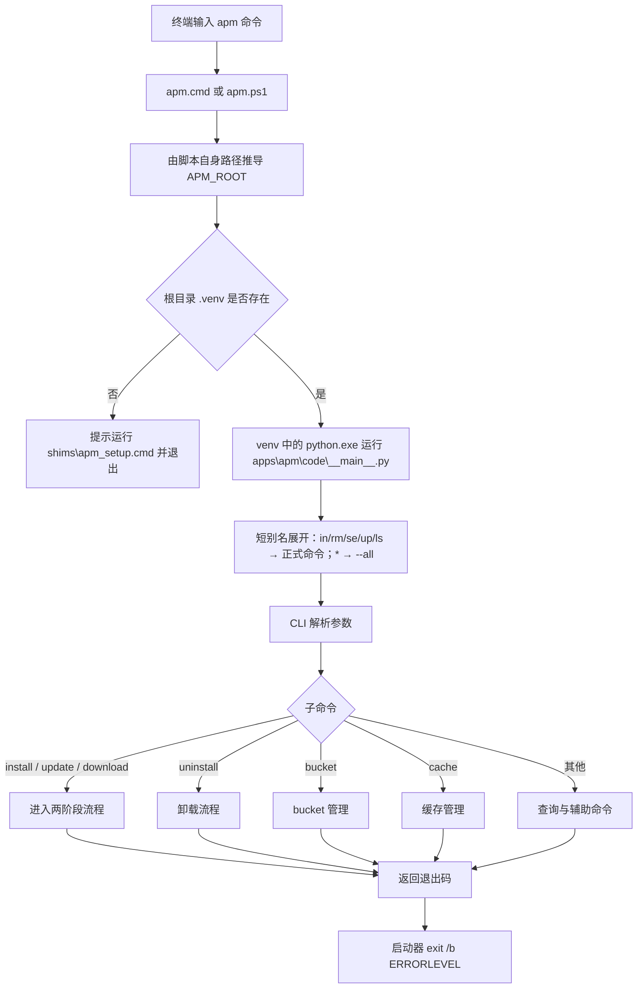

### 13.2 bucket 添加

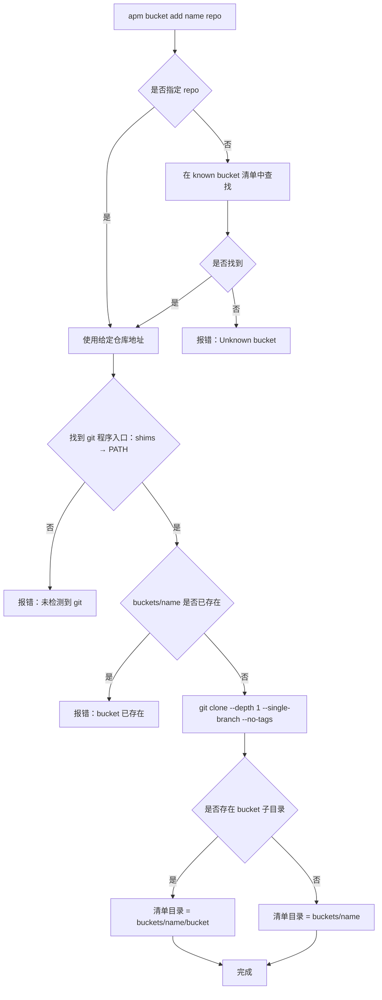

### 13.3 bucket 刷新

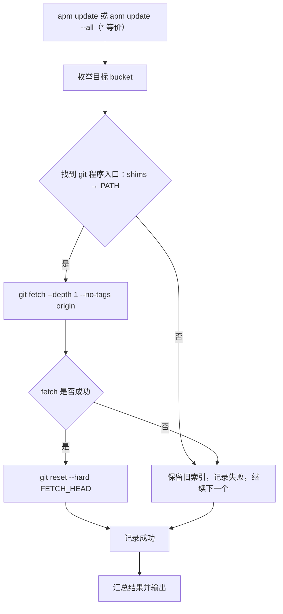

浅克隆约束：

- bucket 只用于读取当前 manifest，`status` 的版本比对也只依赖当前文件，不需要提交历史。
- 克隆固定使用 `--depth 1 --single-branch --no-tags`，更新固定使用 `git fetch --depth 1`，任何情况下都不执行 `unshallow`。
- 更新采用 `fetch + reset --hard FETCH_HEAD`，不做 merge，避免 bucket 强制推送时 `--ff-only` 失败。
- fetch 失败时保留旧索引，本次更新标记失败，不影响已安装软件。

### 13.4 安装（两阶段）

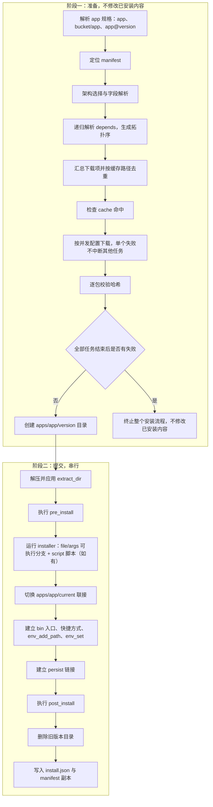

### 13.5 更新

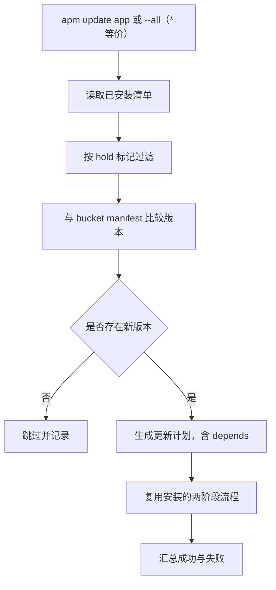

### 13.6 卸载

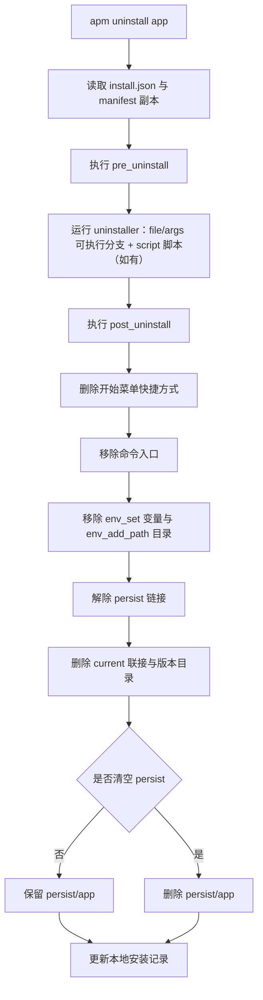

### 13.7 缓存管理

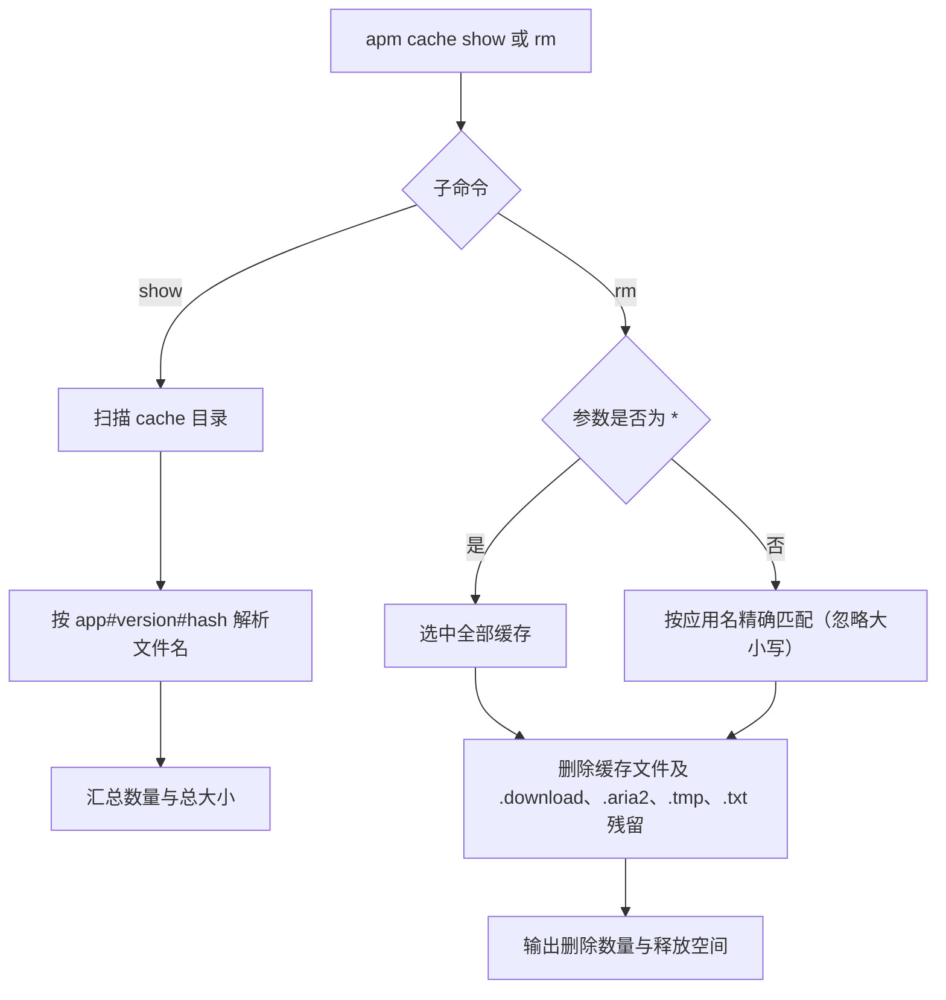

### 13.8 配置加载

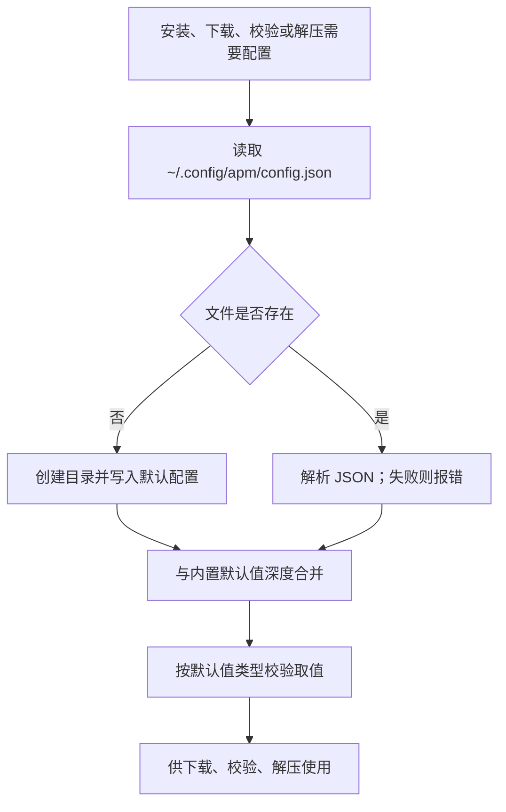

### 13.9 PATH 变更

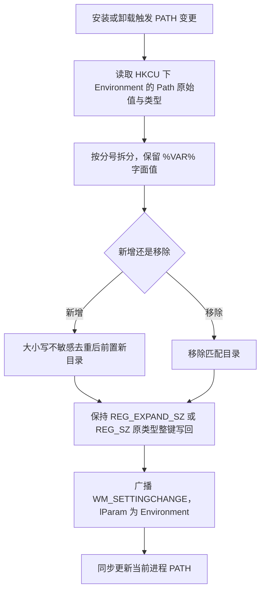

### 13.10 查询类命令

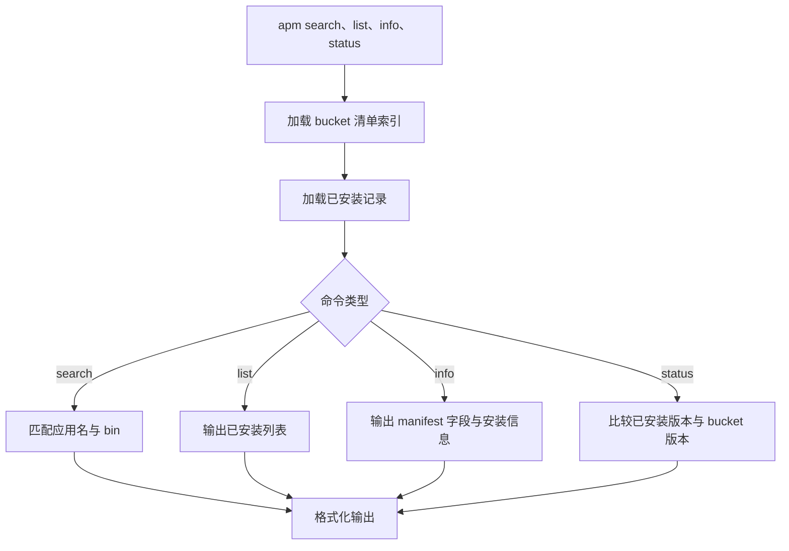

### 13.11 下载后端分支

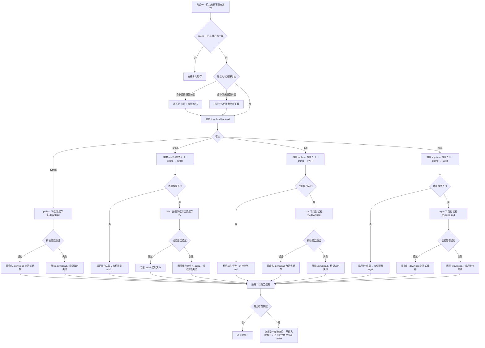

分支规则：

- 后端必须显式指定：`python` / `aria2` / `curl` / `wget`，不静默切换，也不回退到其他后端；APM 层下载失败不重试。
- 地址加速在缓存判断之后、后端选择之前执行；缓存键与哈希匹配始终使用原始 URL。镜像下载失败直接按下载失败处理，无回退、无重试。
- 外部后端的程序入口按「`shims\<exe>` → PATH」两阶段搜索：先找 APM 生成的用户级命令入口，未安装对应应用时才使用 PATH 中的系统版本。`shims` 条目由 manifest 的 `bin` 生成，不按应用目录名或布局猜测。
- 四种后端使用同一套流程骨架：下载 → 校验 → 通过后固化为正式缓存（aria2 额外清理 `.aria2`）；任一步失败都删除本次产生的文件并标记该包失败，不中断其他包的下载。
- 全部下载任务结束后统一判定：只要存在失败，就终止整个安装流程，不进入阶段二；已成功下载的文件保留在 cache，供下次复用。
- `concurrency.apps` 控制同时下载的安装包数量；`concurrency.segments` 只传给 aria2，对应 `--split` 与 `--max-connection-per-server`。python、curl、wget 的单文件并发固定为 1。
- 分片大小不配置，使用下载器默认值。
- 所有后端只负责把字节写入缓存目录；哈希校验、重命名和失败清理统一由 APM 执行。

### 13.12 校验方式分支

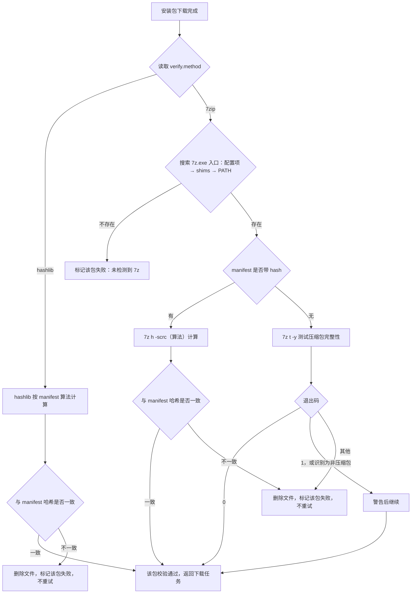

校验失败只影响当前包，其他下载任务继续；全部任务结束后按 13.11 的汇总规则判定是否终止安装。

### 13.13 解压分支

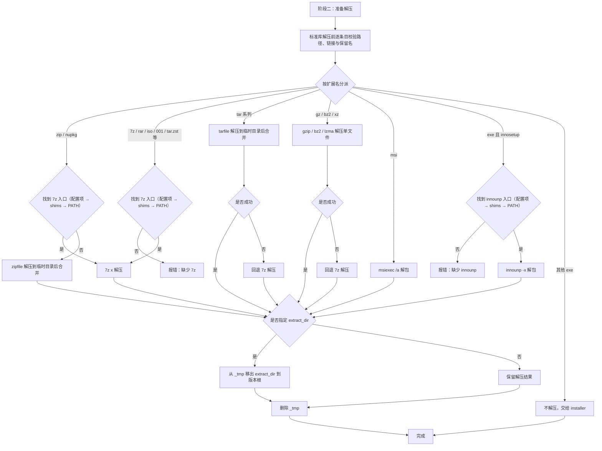

### 13.14 依赖解析

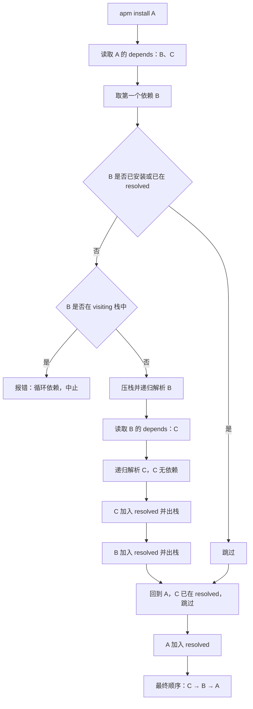

## 14. 许可与合规

- Scoop 核心：Unlicense 或 MIT 双许可；官方 bucket（main、extras、versions、java、nonportable 等）：Unlicense。
- 采用运行时拉取 bucket 的方式，不将第三方清单与安装包内置进 APM 分发包。
- APM 自身使用 GPL-3.0，与上述许可兼容。
- 仓库内 vendored 的 `supporting\shims\kiennq\shim.exe` 来源于 Scoop 参考实现的 shim（kiennq 变体，原生 C），随附 SHA-256 校验文件；其许可与 GPL-3.0 兼容，来源与校验值记录于 `supporting\shims\kiennq\`。
- 后续需补充 `THIRD_PARTY_NOTICES`，保留 Scoop 与各 bucket 的许可声明。
- 产品命名与宣传中不使用 Scoop 的名称与标识暗示官方关联。

## 15. 待补充

- `psmodule` 与 `extract_to` 的支持。
- 内联 PowerShell 的执行策略与安全边界（当前为 `-NoProfile -ExecutionPolicy Bypass -File <临时脚本>`）。
- 缺失 `hash` 时是否提供严格模式（缺失即失败）。
- 代理配置（当前仅沿用进程环境变量）。
- 缓存自动失效策略（当前仅支持手动 `apm cache rm`）。
- 配置文件版本迁移（当前配置无版本字段）。
- 测试策略与验收标准。
- 加固积压（审计已知、未处理）：命令执行无并发互斥锁（PATH/meta 读写竞态）；zip 解压无总量/压缩比限制；`env_set` 未拒绝 `Path` 等保留名；配置文件未知键静默忽略；`main()` 未兜底 `RecursionError`（深层依赖/JSON 触发裸 traceback）。
